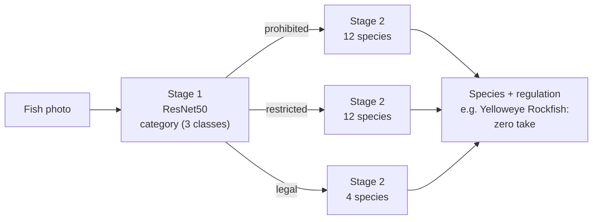
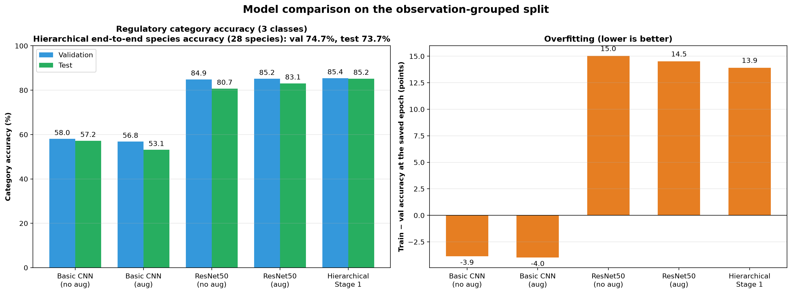

# California Regulated Fish Classifier

Identify a fish from a photo and tell a California recreational angler whether it is **prohibited** (zero take), **restricted** (sub-bag or size limits), or **legal** to keep.

This repository contains the full pipeline: dataset collection, cleaning and splitting, model training (from a basic CNN to a two-stage ResNet50), and evaluation focused on the error that matters most, which is telling an angler that a prohibited fish is legal.

> **Not legal advice.** Fishing regulations change during the year and vary by area. Always confirm against the current [CDFW sport fishing regulations](https://wildlife.ca.gov/Fishing/Ocean/Regulations) before keeping a fish.

## How it works

The final model classifies in two stages. It first decides the regulatory category, then routes the image to a species model trained only on that category.



Because Stage 1 decides which species model is used, a Stage 1 mistake can't be corrected later. A prohibited fish routed to the "legal" model will always come back as a legal species, which is why the evaluation reports Stage 1 errors separately.

## Results

All five models were retrained on the observation-grouped split (no photo of
the same fish in two splits; the evaluation's leakage check finds 0 shared
observations in val and in test).

### Category accuracy (prohibited / restricted / legal)

The basic CNN and ResNet50 scripts train on the three category folders, so they
predict the **category only**, not the species. The hierarchical model's Stage 1
does the same job, so this is the like-for-like comparison.

| Model | Val | Test | Train − val gap |
|---|---|---|---|
| Basic CNN, no augmentation | 58.0% | 57.2% | −3.9 |
| Basic CNN, augmentation | 56.8% | 53.1% | −4.0 |
| ResNet50 transfer learning, no augmentation | 84.9% | 80.7% | 15.0 |
| ResNet50 transfer learning, augmentation | 85.2% | 83.1% | 14.5 |
| **Hierarchical, Stage 1** | **85.4%** | **85.2%** | 13.9 |



The gap is train accuracy minus val accuracy at the saved checkpoint. It is
negative for the basic CNN because its train accuracy is measured with dropout
(and, for one run, augmentation) switched on.

### Hierarchical model, end to end (species and safety)

From `scripts/12_evaluate_hierarchical.py`, with 95% Wilson intervals:

| Metric | Val (734 images) | Test (757 images) |
|---|---|---|
| End-to-end species accuracy (28 species) | 74.7% [71.4–77.7] | 73.7% [70.5–76.7] |
| **Prohibited predicted as legal** | **6.5% [3.9–10.6]** (14/215) | **0.8% [0.2–3.0]** (2/236) |
| Prohibited predicted as restricted | 11.2% [7.6–16.1] | 13.6% [9.8–18.5] |
| Restricted predicted as legal | 7.1% [4.8–10.2] | 8.9% [6.3–12.4] |
| Legal flagged as prohibited (false alarm) | 1.8% [0.6–5.2] | 1.1% [0.3–3.9] |

- **The prohibited → legal rate is uncertain.** Val and test differ by more than
  their intervals suggest is likely, so treat it as somewhere in the 1–6% range,
  not as 0.8%.
- **Stage 1 mistakes are the main cost.** Given the correct category, the species
  models score 83.1% (prohibited), 81.0% (restricted) and 88.0% (legal); end to
  end that falls to 73.7%.
- **Lowering the prohibited threshold helps.** On val, flagging a fish as
  prohibited when P(prohibited) ≥ 0.1 cuts prohibited → legal from 6.5% to 3.7%
  and raises prohibited recall from 83.3% to 90.2%, at the cost of 5.4% of legal
  fish flagged (from 2.4%). See the threshold sweep in
  `evaluation_results/hierarchical_val_report.md`.

Full reports, confusion matrices and every prohibited fish the model missed are
in `evaluation_results/hierarchical_{val,test}_*`.

### Compared with the earlier figures

The previous README reported 91.2% val for the hierarchical model and 89.9% for
ResNet50 with augmentation. Those came from a split that assigned each *photo*
independently, so several photos of one fish could land in both train and
val/test, which inflates accuracy. On the grouped split, category accuracy is
about 85%. Use the numbers above.

### How these were produced

- Apple M4 (MPS), 16 GB, PyTorch 2.15.0, torchvision 0.29.2.
- One run per model with the scripts' default hyperparameters. No random seed is
  set, so a rerun will give slightly different numbers.
- Training time: hierarchical 135 min, ResNet50 79 min (aug) and 88 min (no
  aug), basic CNN about 30 min each.
- Val accuracy is the best epoch's, which is also how the checkpoint was chosen,
  so it is slightly optimistic. Test accuracy is the unbiased figure.

## Dataset

**4,832 images across 28 species** (3,341 train / 734 val / 757 test), split by
iNaturalist observation. 255 of them (5%) are synthetic: 177 train, 37 val,
41 test.

| Category | Species | What it means for an angler |
|---|---|---|
| **Prohibited** (12) | Yelloweye, Quillback, Bronzespotted and Cowcod rockfish; White Shark; Giant Sea Bass; Garibaldi; Green Sturgeon; Gulf Grouper; Broomtail Grouper; Coho Salmon; Steelhead (ocean) | Zero take. Release immediately. |
| **Restricted** (12) | Vermilion, Copper and Canary rockfish; California and Pacific Halibut; White Seabass; California Sheephead; Barred, Kelp and Spotted Sand Bass; Leopard Shark; Chinook Salmon | Can be kept within species-specific bag, size or season limits. |
| **Legal** (4) | Black, Blue, Olive and Gopher rockfish | Can be kept within the general rockfish bag limit. |

**Sources**
- [iNaturalist](https://www.inaturalist.org/): research-grade observations from California
- [FishBase](https://www.fishbase.se/): reference images for rare species
- A local image library (optional)
- Synthetic images generated with Google Gemini for under-represented species (optional, needs `GOOGLE_API_KEY`)

Rare species have few images: seven species have 31–35 training images and only
6–8 test images each (Quillback, Yelloweye, Bronzespotted, Cowcod, Gulf Grouper,
Broomtail Grouper, Pacific Halibut), so their per-species figures have wide
confidence intervals.

**Most rare-species test images are synthetic.** All test images for
Bronzespotted (8), Gulf Grouper (8), Broomtail Grouper (6) and Pacific Halibut
(8), and 7 of 8 for Cowcod, were generated with Gemini. Their per-species recall
therefore shows how well the model recognises generated images of those fish,
not real photos. Real-photo performance on these species is unmeasured.

## Quick start

### 1. Set up the environment
```bash
python3 -m venv venv
source venv/bin/activate
pip install -r requirements.txt
```

### 2. Build the dataset
```bash
./build_dataset.sh
```

This downloads images, optionally generates synthetic images, validates and resizes everything, and creates train/val/test splits **grouped by iNaturalist observation**, so several photos of the same fish never land in different splits.

### 3. Train
```bash
python scripts/07_train.py                              # basic CNN
python scripts/08_train_transfer_learning.py            # ResNet50
python scripts/10_train_hierarchical_classification.py  # two-stage model (recommended)
```

### 4. Predict a single image
```bash
python scripts/11_predict_hierarchical.py path/to/fish_image.jpg
```

### 5. Evaluate
```bash
python scripts/12_evaluate_hierarchical.py              # held-out test split
python scripts/12_evaluate_hierarchical.py --split val  # pick a threshold here
```

### 6. Redraw the charts
The training scripts print their per-epoch metrics, so save each run's output
to `logs/` (names are listed in `scripts/visualizations/training_history.py`):
```bash
mkdir -p logs
python scripts/07_train.py > logs/07_cnn_aug.log 2>&1   # likewise for the other runs
python scripts/visualizations/training_history.py       # logs -> evaluation_results/training_history/
for f in scripts/visualizations/0*.py; do python "$f"; done
```
The exported histories are committed, so the charts can be redrawn without
retraining.

## Evaluation

`12_evaluate_hierarchical.py` runs the full two-stage pipeline on every image in a split, the same way the app would, and writes to `evaluation_results/`:

| File | Contents |
|---|---|
| `hierarchical_<split>_report.md` | Headline metrics, per-category and per-species recall, threshold sweep |
| `hierarchical_<split>_confusion.png` | Category and species confusion matrices |
| `hierarchical_<split>_critical_errors.csv` | Every prohibited fish that was **not** predicted as prohibited, with probabilities |
| `hierarchical_<split>_metrics.json` | Everything above in machine-readable form |

What it measures:

- **Prohibited → legal rate**: the share of zero-take fish the app would say an angler can keep. This is the main safety metric.
- **Per-category recall and precision**, with 95% Wilson confidence intervals.
- **End-to-end species accuracy** and **Stage 2 accuracy with correct routing**. The gap between the two is the cost of Stage 1 mistakes.
- **Per-species recall**, and the share of each species predicted as legal.
- **Threshold sweep**: "flag as prohibited if P(prohibited) ≥ t". Lowering `t` catches more prohibited fish at the cost of more false alarms on legal fish. Choose `t` on the validation split, then report it on test.
- **Leakage check**: warns if any evaluated image shares an iNaturalist observation with a training image.

## Project structure

```
├── build_dataset.sh                     # Runs steps 01–06
├── config.yaml                          # Species list, sources, split ratios
├── scripts/
│   ├── 01_download_inaturalist.py       # Download from iNaturalist
│   ├── 02_download_fishbase.py          # Download from FishBase
│   ├── 03_import_image_library.py       # Import local images
│   ├── 04_generate_synthetic_images.py  # Generate synthetic images (Gemini)
│   ├── 05_preprocess.py                 # Merge, validate, resize; records observation groups
│   ├── 06_create_splits.py              # Observation-grouped train/val/test split
│   ├── 07_train.py / 07_train_no_aug.py # Basic CNN
│   ├── 08_train_transfer_learning*.py   # ResNet50
│   ├── 10_train_hierarchical_classification.py
│   ├── 11_predict_hierarchical.py       # Single-image prediction
│   ├── 12_evaluate_hierarchical.py      # Test-set evaluation + safety metrics
│   ├── utils/                           # Download, image and split helpers
│   └── visualizations/                  # Charts for training curves and model comparison
├── data/
│   ├── raw/                             # Downloaded images (not in git)
│   ├── processed/                       # merged/, train/, val/, test/ (not in git)
│   └── metadata/                        # Species mapping, class counts, source CSVs
├── models/                              # Trained weights (not in git)
└── evaluation_results/                  # Reports and charts
```

## Limitations

- **Category errors are final.** A Stage 1 mistake can't be corrected by Stage 2.
- **Small classes.** Seven species have 31–35 training images.
- **Synthetic test images.** The test sets for the rarest species are mostly or
  entirely Gemini-generated, so accuracy on real photos of those fish is unknown.
- **Overfitting.** The ResNet50-based models reach 99% train accuracy against
  about 85% on val.
- **Regulation text is simplified.** Many species map to "See current regulations"; limits vary by management area and season.
- **Photo conditions.** Most training photos are underwater or well-lit observation photos. Accuracy on deck photos, partially visible fish, or juveniles is unmeasured.

## License

MIT for the code. Images keep their original licenses (CC-BY, CC0, CC-BY-NC); see `data/metadata/*.csv` for each image's source and license.

## Acknowledgments

iNaturalist community observers, the FishBase database, and Google Gemini for synthetic images.
