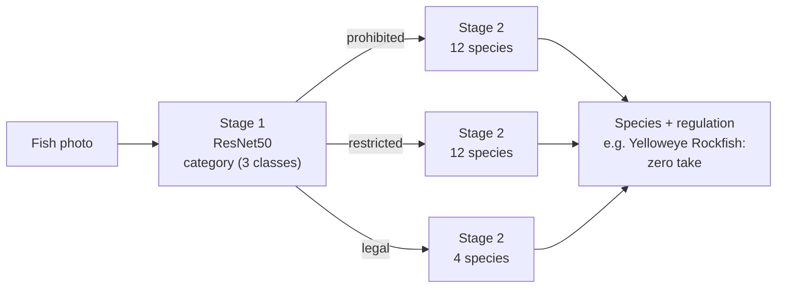

# California Regulated Fish Classifier

Identify a fish from a photo and tell a California recreational angler whether it is **prohibited** (zero take), **restricted** (sub-bag or size limits), or **legal** to keep.

This repository contains the full pipeline: dataset collection, cleaning and splitting, model training (from a basic CNN to a two-stage ResNet50), and evaluation focused on the error that matters most, which is telling an angler that a prohibited fish is legal.

> **Not legal advice.** Fishing regulations change during the year and vary by area. Always confirm against the current [CDFW sport fishing regulations](https://wildlife.ca.gov/Fishing/Ocean/Regulations) before keeping a fish.

## How it works

The final model classifies in two stages. It first decides the regulatory category, then routes the image to a species model trained only on that category.



Because Stage 1 decides which species model is used, a Stage 1 mistake can't be corrected later. A prohibited fish routed to the "legal" model will always come back as a legal species, which is why the evaluation reports Stage 1 errors separately.

## Results

| Model | Val accuracy | Test accuracy |
|---|---|---|
| Basic CNN (no augmentation) | 57.4% | 56.4% |
| Basic CNN (augmentation) | 54.4% | 56.0% |
| ResNet50 transfer learning (no augmentation) | 85.9% | 85.5% |
| ResNet50 transfer learning (augmentation) | 89.9% | not yet measured |
| **Hierarchical, 2-stage** | **91.2%** | not yet measured |

Test-set results for the hierarchical model, including the prohibited → legal error rate, are produced by `scripts/12_evaluate_hierarchical.py` (see [Evaluation](#evaluation)).

> **Caveat on these figures.** They were produced with an earlier split that assigned each *photo* to train/val/test independently. 870 of 2,801 iNaturalist observations contain several photos of the same fish, so near-duplicates could sit on both sides of the split, which inflates accuracy. The pipeline now splits by observation. Rebuild the splits and retrain before quoting final test numbers.

## Dataset

**4,905 images across 28 species** (3,403 train / 745 val / 757 test).

| Category | Species | What it means for an angler |
|---|---|---|
| **Prohibited** (12) | Yelloweye, Quillback, Bronzespotted and Cowcod rockfish; White Shark; Giant Sea Bass; Garibaldi; Green Sturgeon; Gulf Grouper; Broomtail Grouper; Coho Salmon; Steelhead (ocean) | Zero take. Release immediately. |
| **Restricted** (12) | Vermilion, Copper and Canary rockfish; California and Pacific Halibut; White Seabass; California Sheephead; Barred, Kelp and Spotted Sand Bass; Leopard Shark; Chinook Salmon | Can be kept within species-specific bag, size or season limits. |
| **Legal** (4) | Black, Blue, Olive and Gopher rockfish | Can be kept within the general rockfish bag limit. |

**Sources**
- [iNaturalist](https://www.inaturalist.org/): research-grade observations from California
- [FishBase](https://www.fishbase.se/): reference images for rare species
- A local image library (optional)
- Synthetic images generated with Google Gemini for under-represented species (optional, needs `GOOGLE_API_KEY`)

Rare species have few images. Several prohibited species (Bronzespotted, Gulf Grouper, Broomtail Grouper) have only 8–10 test images each, so their individual recall figures have wide confidence intervals.

## Quick start

### 1. Set up the environment
```bash
python3 -m venv venv
source venv/bin/activate
pip install -r requirements.txt
```

### 2. Build the dataset
```bash
./build_dataset.sh
```

This downloads images, optionally generates synthetic images, validates and resizes everything, and creates train/val/test splits **grouped by iNaturalist observation**, so several photos of the same fish never land in different splits.

### 3. Train
```bash
python scripts/07_train.py                              # basic CNN
python scripts/08_train_transfer_learning.py            # ResNet50
python scripts/10_train_hierarchical_classification.py  # two-stage model (recommended)
```

### 4. Predict a single image
```bash
python scripts/11_predict_hierarchical.py path/to/fish_image.jpg
```

### 5. Evaluate
```bash
python scripts/12_evaluate_hierarchical.py              # held-out test split
python scripts/12_evaluate_hierarchical.py --split val  # compare with the 91.2% val figure
```

## Evaluation

`12_evaluate_hierarchical.py` runs the full two-stage pipeline on every image in a split, the same way the app would, and writes to `evaluation_results/`:

| File | Contents |
|---|---|
| `hierarchical_<split>_report.md` | Headline metrics, per-category and per-species recall, threshold sweep |
| `hierarchical_<split>_confusion.png` | Category and species confusion matrices |
| `hierarchical_<split>_critical_errors.csv` | Every prohibited fish that was **not** predicted as prohibited, with probabilities |
| `hierarchical_<split>_metrics.json` | Everything above in machine-readable form |

What it measures:

- **Prohibited → legal rate**: the share of zero-take fish the app would say an angler can keep. This is the main safety metric.
- **Per-category recall and precision**, with 95% Wilson confidence intervals.
- **End-to-end species accuracy** and **Stage 2 accuracy with correct routing**. The gap between the two is the cost of Stage 1 mistakes.
- **Per-species recall**, and the share of each species predicted as legal.
- **Threshold sweep**: "flag as prohibited if P(prohibited) ≥ t". Lowering `t` catches more prohibited fish at the cost of more false alarms on legal fish. Choose `t` on the validation split, then report it on test.
- **Leakage check**: warns if any evaluated image shares an iNaturalist observation with a training image.

## Project structure

```
├── build_dataset.sh                     # Runs steps 01–06
├── config.yaml                          # Species list, sources, split ratios
├── scripts/
│   ├── 01_download_inaturalist.py       # Download from iNaturalist
│   ├── 02_download_fishbase.py          # Download from FishBase
│   ├── 03_import_image_library.py       # Import local images
│   ├── 04_generate_synthetic_images.py  # Generate synthetic images (Gemini)
│   ├── 05_preprocess.py                 # Merge, validate, resize; records observation groups
│   ├── 06_create_splits.py              # Observation-grouped train/val/test split
│   ├── 07_train.py / 07_train_no_aug.py # Basic CNN
│   ├── 08_train_transfer_learning*.py   # ResNet50
│   ├── 10_train_hierarchical_classification.py
│   ├── 11_predict_hierarchical.py       # Single-image prediction
│   ├── 12_evaluate_hierarchical.py      # Test-set evaluation + safety metrics
│   ├── utils/                           # Download, image and split helpers
│   └── visualizations/                  # Charts for training curves and model comparison
├── data/
│   ├── raw/                             # Downloaded images (not in git)
│   ├── processed/                       # merged/, train/, val/, test/ (not in git)
│   └── metadata/                        # Species mapping, class counts, source CSVs
├── models/                              # Trained weights (not in git)
└── evaluation_results/                  # Reports and charts
```

## Limitations

- **Category errors are final.** A Stage 1 mistake can't be corrected by Stage 2.
- **Small classes.** Several prohibited species have under 50 training images.
- **Regulation text is simplified.** Many species map to "See current regulations"; limits vary by management area and season.
- **Photo conditions.** Most training photos are underwater or well-lit observation photos. Accuracy on deck photos, partially visible fish, or juveniles is unmeasured.

## License

MIT for the code. Images keep their original licenses (CC-BY, CC0, CC-BY-NC); see `data/metadata/*.csv` for each image's source and license.

## Acknowledgments

iNaturalist community observers, the FishBase database, and Google Gemini for synthetic images.
